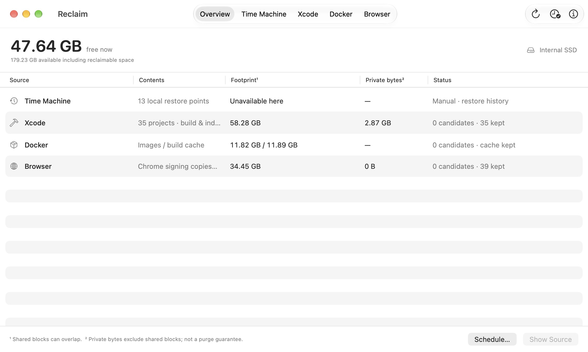

# Reclaim

A native SwiftUI utility for freeing space held by known developer storage
sources: local Time Machine snapshots, Xcode build data, Docker and Chrome.



## Motivation

**Finder can show 100+ GB available while a build tool sees only about 5 GB
actually free and stops.** The user has repeatedly encountered builds failing
before macOS releases purgeable storage. Reclaim makes physically free space
visible and offers explicit cleanup of specific sources, without a broad disk
scan. Not every supported cache is classified as purgeable by macOS.

Reclaim is a **conservative safety net**. Project tools should manage their own
worktrees and build caches. Surviving source projects and registered worktrees
are protected; uncertain ownership or usage keeps the data. It is expected that
a large footprint can have no cleanup candidates.

The [product brief](docs/PRODUCT.md) records this motivation, scope and design
choices. [Development instructions](AGENTS.md) preserve them for future work.

## Build and run

Runs on macOS 14 or later. Build with Xcode 27 or later (or its Command Line
Tools and macOS SDK) and Swift 6. No third-party dependencies.

```sh
swift test
./scripts/build-app.sh
open dist/Reclaim.app
```

Open `Package.swift` in Xcode to develop. `--demo` shows sample snapshot/storage
figures with mutation disabled. The generated app is signed locally. The manual
GitHub release workflow builds, signs and notarizes the distribution; see
[release setup](docs/RELEASING.md). The old bundle identifier
`local.timemachinexray.app` is retained to preserve the existing app identity.

`Resources/Reclaim.png` is the approved purple mark on a pale lilac background,
without a label. It is preserved unchanged as the artwork master. Packaging
exports the standard macOS icon sizes into `Reclaim.icns`; the website uses the
same artwork. `VERSION` is the release version; `BUILD_NUMBER` supplies a numeric
build number (GitHub's run number for CI, otherwise the local development value).

## Interface

Overview summarizes the known sources. The toolbar tabs open native tables for
Time Machine, Xcode, Docker and browser data. There is no navigation sidebar.
**Free now** is unallocated APFS container space; **available** is macOS's
estimate for important usage and includes potentially reclaimable data. It may
differ from Finder. Shared blocks mean the source sizes cannot be added together
as a promise of recovered space.

The unified toolbar uses native Liquid Glass action groups and a centered AppKit
segmented source control, following Activity Monitor. AppKit sizes the tab
selection within a single system toolbar glass background. Older systems retain
their native appearance. The packaging script records the actual build SDK
separately from the macOS 14 deployment target so current systems use their
current control styling.

| Source | Inspection and manual cleanup | Automatic rule |
| --- | --- | --- |
| Time Machine | Internal Data volume only; ask macOS to thin by a GB target or delete selected restore points | Manual only; requires system authorization |
| Xcode | Build and Index folders from verified orphaned DerivedData projects only | Sources gone, no registered worktree, inactive for 7 days, no build tools or file users |
| Docker | Relay engine usage and unique/shared sizes; remove only untagged images older than 24 hours with zero container references and no reported active builder | None; build cache is inspection-only |
| Chrome | Temporary signing copies; standard Cache/Code Cache folders are inspection-only | Signing copies older than 24 hours with no matching process or file users |

Browser caches are inspection-only. Chrome signing copies come from the current
user's `X/com.google.Chrome.code_sign_clone/code_sign_clone.<six characters>`
folder adjacent to the macOS temporary directory. They must contain exactly a
recognized `Google Chrome.app.bundle`. Reclaim matches executable paths and open
or mapped files to each copy and shows the process IDs that protect it. Unrelated
Chrome instances can remain running. Failed inspection keeps the copy. Reclaim
preserves the installed app and browser profiles.

Xcode cleanup preserves SourcePackages, logs, archives, simulators and source
projects. Only Build, Index.noindex and Index folders are eligible. Rebuilding
and indexing can take longer after cleanup. Shared DerivedData caches are not
included in this version. The source workspace and its parent must both be
confirmed absent. Reclaim checks direct repositories under `~/repos` and Git's
registered worktrees, including paths outside that folder and missing worktrees.
Existing sources and registered worktrees are kept regardless of age. Incomplete
inventory, recent contained files or project access, build processes, and open
files also prevent cleanup. Ownership and usage are checked again before removal.

Docker commands explicitly target the local Unix socket at
`~/.docker/run/docker.sock`. Remote contexts are not used. Containers and volumes
are never deleted. As in Docker Desktop, an image is unused only when no running
**or stopped** container references it. Reclaim additionally protects all tagged
images and recent images. Docker's normal refusal checks remain enabled; removal
is never forced. Build cache is kept even when the engine reports it unused,
because that does not establish that its project is inactive. Docker's virtual
disk can return host space after a delay.

### Shared blocks and snapshot sizes

**File blocks / Footprint** counts allocated file blocks, which can overlap between
APFS clones or snapshots. **Private bytes** separately sums macOS's per-file
`ATTR_CMNEXT_PRIVATESIZE` values: bytes not retained by another clone or snapshot.
Multiply linked files and directory metadata are excluded. Unsupported measurements
show `—`. This conservative sum can underestimate deleting a group together, and
neither column guarantees recovered space. Docker's image and cache totals remain
separate, with unique/shared layer sizes in the detail table.

The original SSD free/available figures were not per-snapshot sizes. The snapshot
listing command used by Reclaim does not return private or cumulative size on
this Mac. **Disk Utility can display both**; the Time Machine tab explains how
and includes a shortcut. Reclaim leaves snapshot sizes unknown instead of using
the available-space gap or adding shared file sizes. Never sum cumulative sizes.

## Schedules

Open **Cleanup schedule** (clock icon, or the Overview footer). Choose an hourly,
six-hourly or daily check and the sources to clean. Scheduling is **off by default**.
Saving an enabled schedule requires confirmation. It installs a per-user
LaunchAgent and a copied helper that works while Reclaim is closed. There is no
cleanup at app launch or immediately on saving. Jobs run while logged in; sleeping,
a busy app, or failed inspection can delay or skip cleanup. Only Chrome signing
copies and orphaned Xcode data can be scheduled. Older configurations requesting
Docker cache cleanup are recorded as skipped; no prune is run.

The app recognizes the existing `com.torben.chrome-clone-cleanup` job only if its
configuration matches the known hourly, older-than-12-hours rule and exact Chrome
folder. Selecting **Replace the existing job** backs up its plist, unloads it and
removes its original plist so it cannot return at login. If registration fails,
Reclaim restores the previous configuration. The new rule uses a 24-hour minimum
plus process and open-file checks. It refuses to schedule overlapping
Chrome cleanup without this explicit takeover. A running old job must finish
before replacement. Turning Reclaim scheduling off does not reactivate the old job.

Files installed only when settings are saved:

- `~/Library/LaunchAgents/local.reclaim.cleanup.plist`
- `~/Library/Application Support/Reclaim/ReclaimWorker`
- `~/Library/Application Support/Reclaim/schedule.json`
- `~/Library/Application Support/Reclaim/last-run.json` (last completed run)
- Backups of the replaced job in the same support directory.

The settings panel shows the last run and per-source outcomes. A process lock
prevents manual and scheduled Reclaim cleanups from overlapping. No privileged
helper or root daemon is installed. To uninstall scheduling, switch it off in the
app and save before removing Reclaim. A saved legacy-job backup can be restored
manually after disabling Reclaim's schedule; the app does not silently restart it.

## Time Machine scope and permissions

All snapshot commands target `/System/Volumes/Data`, verified as internal APFS.
External or network backups are never listed or modified. Only strict
`com.apple.TimeMachine.<timestamp>.local` names are eligible; OS update snapshots
are excluded. Local snapshots are not a reliable “waiting to back up” queue.

Thinning uses `tmutil thinlocalsnapshots` with the internal volume. Selected
removal uses `diskutil apfs deleteSnapshot` with the exact volume and snapshot
name. Date-based `tmutil deletelocalsnapshots` is prohibited because it also
operates on matching dates on other mounted disks.

Manual snapshot actions confirm their scope, then use macOS's administrator
authorization dialog. Reclaim does not collect or store passwords. Removing local
restore history is permanent, and may discard the only historical version of a
file not yet backed up. Current files and external backups are kept.

The app is unsandboxed. If macOS denies a disk operation, its policy may require
Full Disk Access for Reclaim. Scheduled work never prompts for elevated access;
permission failures are recorded as skipped or incomplete work.

## Verification

`swift test` covers strict snapshot names, local-volume scope, stale selections,
authorization cancellation, Docker usage/tag/age policy and command scope,
repository/worktree ownership, stale usage checks, APFS clone and hard-link sizes,
Chrome identity/24-hour/process/open-file checks, schedule validation, explicit legacy-job
takeover, failure rollback, and process locking. Destructive paths use generated
temporary fixtures or mock command runners; tests do not purge real user data or
register real background services.

Read-only UI checks use real inventory. Cleanup batches may complete partially
before an error; the app refreshes after every action. Changes in free space can
also reflect unrelated disk activity. Neither displayed sizes nor a requested
Time Machine target guarantee recovered space.
